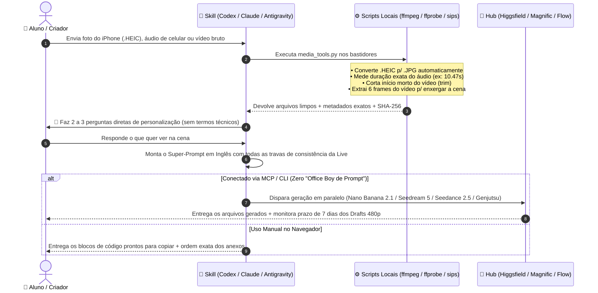

# ⚡ Human Academy + PAULO.IA — Open-Source Creative Pipeline & Skills Suite

> **"Enquanto os falsos gurus pegam o que a Human e o Paulo ensinam de graça para vender curso de R$ 79,90, este repositório faz exatamente o oposto: pega a aula histórica deles, transforma em engenharia de agentes 100% gratuita e devolve para a comunidade."**

[](https://www.youtube.com/watch?v=y62nWkfsoQs)
[-Human_Academy-EAB308?style=for-the-badge)](https://s.humanacademy.ai/portaldablack)
[-Academy_Plus_Vitalício-000000?style=for-the-badge)](https://s.humanacademy.ai/blackliveyd)


**Versão atual:** [v1.0.0](./CHANGELOG.md) · Licença MIT
---

## 🎯 Por Que Este Repositório Existe? (Manifesto Anti-Guru)

Na noite de **15 de outubro**, **Paulo Aguiar (`@paulo.ia`)**, **Mário (`@marioo____`)** e **Nando Blum (`@nandoblum`)** fizeram uma live de **2 horas e 20 minutos** que colocou no chinelo 99% dos cursos pagos do mercado.

Eles não fizeram "bolo pronto de programa de culinária": **abriram a cozinha ao vivo**. Tiraram foto de celular na hora, gravaram áudio no meio do estúdio, mostraram os bastidores completos de campanhas gigantes (como *Fanta Halloween / Coca-Cola*, *Heineken*, *Boticário*, *Nestlé/Nescau*, *iFood BBB* e o viral de **200+ milhões de views** do *Messi & Yamal*) e liberaram gratuitamente os prompts e a skill de *Character Sheet*.

Durante a live, eles comentaram algo muito real:
> *"Tem muita gente vendendo curso e ganhando grana com o conteúdo que está gratuito no nosso Instagram e nas nossas lives... Cuidado com esses gurus."*

**Este projeto nasceu para ir na contramão dos oportunistas:**
1. Eu assisti, transcrevi e dissequei cada minuto dos **140 minutos da Live 01**.
2. Peguei não apenas os **4 super-prompts oficiais** e a skill **`character-sheet-studio`** que o Mário disponibilizou no Portal do Aluno, mas também **todos os "pulos do gato" falados ao vivo** que não estavam escritos nos prompts (como a técnica de refutação do *Vassão*, o fluxo *Draft 480p $\rightarrow$ 1080p* de 7 dias, o *workaround* do Paulo para plataformas sem Draft, a gravação física do áudio para Lip Sync, a regra `SFX Only / No Music` e a conversão automática de `.HEIC`).
3. Empacotei tudo em uma **Suíte Open-Source de 6 Agent Skills** (compatível com **OpenAI Codex**, **Claude Code** e **Google Antigravity**), além de um **E-book/Tutorial em PDF diagramado**, para que qualquer aluno da comunidade consiga rodar a **Pipeline Completa** com perguntas interativas de personalização!

---

## 👑 Créditos Totais aos Mestres (Sigam e Acompanhem!)

Nada aqui existiria sem a generosidade absurda e a visão de mercado desses três caras e de todo o time da **Human Academy** (a maior escola e ecossistema de IA para o mercado criativo, com mais de **35.000 alunos formados**):

| Criador / Instituição | Papel | Onde Seguir |
| :--- | :--- | :--- |
| **Paulo Aguiar (`@paulo.ia`)** | Diretor de Criação (ex-Publicis/Heineken/Bradesco/Next/3C), Creator (NVIDIA Partner, ChatGPT Creative Partner) & Professor na Human Academy | [Instagram `@paulo.ia`](https://www.instagram.com/paulo.ia/) |
| **Mário (`@marioo____`)** | Co-fundador & Diretor Criativo na Human Academy — o homem que faz *Lip Sync*, *Character Sheet* e *VFX* ao vivasso sem rede de proteção | [Instagram `@marioo____`](https://www.instagram.com/marioo____/) |
| **Nando Blum (`@nandoblum`)** | Co-fundador na Human Academy — visão de negócio, posicionamento de mercado e direção executiva de estúdio | [Instagram `@nandoblum`](https://www.instagram.com/nandoblum/) |
| **Human Academy** | O maior ecossistema de IA criativa do Brasil (Estúdio + Academy + Corporate) | [Portal da Black](https://s.humanacademy.ai/portaldablack) · [Inscrição Dia 11/11](https://s.humanacademy.ai/blackliveyd) |

> *(Salve especial também para a galera braba citada na live: **Gabriel** e **Mari** do time do Paulo, **Gabi**, **Ju**, **Ana**, **Pompeu**, **Vitor/Vitão**, **Ortega / Hey Listener**, **Celso**, **André do Amaral / Savee.it** e **Raoni Lima**!)*

### 🚨 Recado para quem está chegando agora:
No dia **11 de Novembro** vai rolar a abertura oficial do **Human Academy Plus (Vitalício)** na Black Friday deles — com acesso vitalício a todas as formações (*Create, Filmmaker, Design, Agentes, Build, Storytelling, Creative Core*), **2 horas de Hotline semanal ao vivo com Experts** e **Breakdowns mensais de 1 hora com o Paulo Aguiar** abrindo projetos de grandes marcas de ponta a ponta.
👉 **Garanta seu cadastro gratuito para ser avisado:** **[https://s.humanacademy.ai/blackliveyd](https://s.humanacademy.ai/blackliveyd)**

---

## 🧠 O Que Este Pacote Faz na Prática?

Na live, o Paulo explicou a equação fundamental do trabalho criativo com IA:

$$\text{Resultado} = \frac{(\text{Processo Criativo} + \text{Melhores Ferramentas}) \times \text{Repertório}}{\text{Controle}}$$

E deixou uma dica de ouro sobre **Skills**:
> *"Você pode pedir para o Codex, Claude Code ou Antigravity transformar esses prompts em uma Skill... Inclusive, peça: 'quero que essa Skill faça perguntas para o usuário antes de começar'."*

**Pedido feito, pedido executado!** Construímos uma arquitetura que funciona tanto como uma **Produtora Completa Ponta a Ponta** quanto como **5 Estúdios Especialistas Independentes**.

---

## 🗺️ Desenho Visual da Arquitetura

### 1. Como Funciona a Pipeline Completa (`creative-pipeline-director`)

Quando você chama a skill mestre, ela não sai gerando coisas aleatórias e queimando seus créditos. Ela conduz o **Fluxo Alternado (Humano $\leftrightarrow$ IA)** em uma única conversa, parando em **4 Portões de Personalização**:

```mermaid
flowchart TD
    Start(["🎬 Você inicia: /creative-pipeline-director"]) --> Router{"Como você quer criar hoje?"}

    %% ROTA 1: PIPELINE COMPLETA
    Router -->|"1. Projeto Completo (Da Ideia ao Filme)"| Step1["🧠 ETAPA 1: Ideação & Refutação"]

    subgraph Gate1 ["💬 PORTÃO DE PERSONALIZAÇÃO 1: Ideia & Roteiro"]
        Step1 --> G1A["1. Descarte de Clichês: A IA lista as 3 ideias óbvias que todo mundo faria e as descarta"]
        G1A --> G1B["2. Devil's Advocate (Método Vassão): 'Por que sua ideia pode flopar?' (1 a 2 rodadas p/ blindar)"]
        G1B --> G1C["3. Roteiro 2 Colunas (Fala vs. Ação): Rascunho da IA + Reescrita com o seu toque humano"]
    end

    G1C --> Step2["🧩 ETAPA 2: Fábrica de Assets ('Os Ingredientes')"]

    subgraph Gate2 ["💬 PORTÃO DE PERSONALIZAÇÃO 2: Identidade & Cenários"]
        Step2 --> G2A["1. Character Sheet Studio: Rosto real intocado + Corpo sem cabeça gerado"]
        G2A --> G2B["2. Perguntas Pro: Trocar look? Qual a altura (cm)? Tem close de tatuagem/óculos?"]
        G2B --> G2C["3. Product Sheet + Props estilo 'GTA' (livres de direitos) + Cenários guiados pela cor do produto"]
    end

    G2C --> Step3["🎨 ETAPA 3: Storyboard Ilustrado & Fotografia"]

    subgraph Gate3 ["💬 PORTÃO DE PERSONALIZAÇÃO 3: Aprovação Visual"]
        Step3 --> G3A["1. Storyboard no mesmo chat (1 quadro/seg) forçando referência de traço de desenho"]
        G3A --> G3B["2. Opcional: Variação de Ângulos (Nano Banana 2.1) ou Ensaio Editorial (20 fotos em paralelo)"]
    end

    G3B --> Step4["🎥 ETAPA 4: Filme Comercial, Lip Sync & VFX"]

    subgraph Gate4 ["💬 PORTÃO DE PERSONALIZAÇÃO 4: Render & Economia de Créditos"]
        Step4 --> G4A["1. Áudio medido via ffprobe + pausas via Whisper + Dica de gravar áudio em movimento"]
        G4A --> G4B["2. Trava obrigatória: 'SFX Nativo Limpo / SEM Música de Fundo' (para não estragar o corte)"]
        G4B --> G4C["3. Fluxo Estúdio: Gera em Draft 480p -> Edita no DaVinci/CapCut -> Upscale 1080p em até 7 dias"]
    end

    G4C --> Finish(["🏆 Entrega Completa:\nAssets + Storyboard + Prompts + Vídeos Finais"])

    %% ROTA 2: SKILL INDIVIDUAL
    Router -->|"2. Usar apenas 1 Técnica Rápida"| FastTrack["⚡ Aciona diretamente uma das 5 Sub-Skills Especialistas"]
    FastTrack --> Finish
```



---

### 2. Como Funciona Cada Skill Especialista por Dentro

Ao contrário de um prompt estático de bloco de notas, cada Skill desta suíte possui **scripts Python embutidos (`media_tools.py` e `session_manager.py`)** que preparam seus arquivos automaticamente antes de falar com os geradores:



---

## 🛠️ As 6 Skills da Suíte (E os "Segredos da Live" Embutidos em Cada Uma)

Todas as skills foram validadas segundo a especificação oficial de Agent Skills e incluem os prompts originais + as adaptações que o Mário, o Paulo e o Nando fizeram ao vivo:

### 1. `creative-pipeline-director` (O Diretor de Criação / Playbook Mestre)
- **O que faz:** Orquestra um projeto do zero até a entrega final mantendo um `project-session.json` vivo.
- **Pulos do gato da live incluídos:**
  - **Filtro Anti-Clichê:** Gera as 3 primeiras ideias óbvias apenas para descartá-las na sua frente.
  - **Método Vassão (*Devil's Advocate*):** Critica sua ideia apontando por que ela floparia (limitado a no máximo 2 rodadas para você não desistir do projeto).
  - **Pesquisa Histórica/Factual (Case Messi & Yamal):** Checa dados reais de época (uniformes, patrocinadores, estatura) antes de gerar séries temporais.
  - **Props "Estilo GTA" & Cenários por Cor (Case Fanta):** Descaracteriza carros/objetos de marca para ficarem livres de bloqueio de direitos autorais e cria locações guiadas pela paleta de cores da embalagem.

### 2. `character-sheet-studio` (Character Sheet & Product Sheet)
- **O que faz:** A skill oficial mostrada na live, que preserva os bytes originais das fotos reais do rosto (frente e perfil) e gera apenas os corpos sem cabeça, compondo o board 8:3 (`#808080`) em PNG e HTML.
- **Upgrades da live incluídos:**
  - **Modo Product Sheet:** Adaptação automática para criar pranchas de produtos/latas com todas as vistas e closes de rótulo.
  - **Troca de Look (*Wardrobe Swap*):** Permite mandar suas fotos de rosto, mas anexar uma roupa do Pinterest ou camisa de marca para vestir o corpo gerado.
  - **Inferência de Costas:** Se você não tirou foto de costas e está com roupa lisa (ex: todo de preto, como o Paulo na live), ela infere as costas sem travar o fluxo.
  - **Trava de Altura (em cm) & Closes de Tatuagem/Óculos:** Evita que a IA mude a proporção entre personagens (ex: Paulo e Vicky) e guarda fotos separadas de tatuagens complexas (como a *Kitsune* no pescoço) e óculos (*Oakley / Ray-Ban Meta*).

### 3. `experimental-angles-studio` (Variação de Ângulos Inusitados)
- **Baseada em:** `01 — Fotografia Experimental: Ângulos Inusitados`
- **O que faz:** A partir de 1 única foto, cria 5+ pontos de vista radicais e fisicamente plausíveis (*"Onde colocaram essa câmera?"*).
- **Pulos do gato da live incluídos:**
  - **Auto-conversão de `.HEIC` do iPhone:** Na live, a foto do iPhone travou ao subir no Higgsfield; a skill já converte `.HEIC`/`.WEBP` para `.JPG` automaticamente no Passo 1.
  - **Fidelidade à Estética de Celular:** Impede a IA de colocar "luz falsa de cinema", mantendo a luz real do ambiente e o sapato exato da foto.
  - **Menu de Pós-Ângulos Rápidos:** Já oferece os comandos extras que o Mário e o Paulo pediram ao vivo: **Fisheye bem distorcida de baixo** e **Selfie segurando a câmera com a mãozona perto da lente**.

### 4. `editorial-photoshoot-studio` (Ensaio Fotográfico Editorial)
- **Baseada em:** `02 — Ensaio Fotográfico Editorial`
- **O que faz:** Cruza seu *Character Sheet* (Imagem 1) com 3 a 5 referências estéticas do Pinterest/Savee.it (Imagens 2+) para criar um ensaio autoral de 10 a 20 retratos sem copiar a foto de referência.
- **Pulos do gato da live incluídos:**
  - **Disparo de Volume em Paralelo (`"Gere tudo em paralelo"`):** Instrui o conector a rodar 20 imagens simultaneamente (e não de 4 em 4), permitindo comparar **Nano Banana 2.1 (2K High)** vs. **Seedream 5 Pro**.
  - **Checklist de Curadoria:** Verifica automaticamente detalhes como símbolos de tatuagem, olhos legíveis atrás dos óculos e se o calçado não saiu sem meia.

### 5. `seedance-commercial-director` (Vídeo Multi-Cenários com Lip Sync Real)
- **Baseada em:** `03 — Gerador de Prompts Seedance 2.5`
- **O que faz:** Dirige vídeos publicitários onde o personagem caminha e fala por 5 cenários contínuos com estética *IMAX 65mm* e câmera dinâmica (*whip pans*, *dolly-in*, arcos de 60°–90°).
- **Pulos do gato da live incluídos:**
  - **Dica de Atuação Física no Áudio:** Lembra você de gravar o áudio andando se o personagem estiver andando no vídeo (para a respiração e cadência da voz ficarem reais).
  - **Medição Automática (`ffprobe` + `whisper`):** Calcula os segundos exatos do seu áudio (ex: `10.47s`) e mapeia as pausas reais das frases.
  - **Regra `SFX Only / No Background Music`:** Proíbe trilha musical automática para que você aproveite os efeitos sonoros nativos do Seedance na sua edição sem cortes de música.
  - **Gestão do Modo Draft 480p $\rightarrow$ 1080p (Contador de 7 Dias + Workaround):** Registra seus rascunhos 480p e avisa do prazo de **7 dias** para converter os takes aprovados da timeline em 1080p. Se sua plataforma não tiver botão de Draft (ou se passarem os 7 dias), aplica o *workaround* do Paulo anexando o vídeo 480p como referência de controle de câmera!

### 6. `cinema-vfx-supervisor` (Efeitos Visuais de Cinema & Character Swap)
- **Baseada em:** `04 — Supervisor de Efeitos Visuais para Cinema` + Fluxo *Genjutsu / Motion Control*
- **O que faz:** Aplica transformações surreais fotorrealistas em vídeos reais (ex: raízes e floresta tomando conta do estúdio) ou substitui o ator por outro personagem/fantasia.
- **Pulos do gato da live incluídos:**
  - **Extração de Frames + Trim Automático (`ffmpeg`):** Corta o comecinho morto do vídeo onde você ainda estava apertando o botão do celular e extrai 6 frames para o agente enxergar sua cena real antes de fazer perguntas.
  - **Dica de Movimento Natural de Câmera:** Orienta você a sair e voltar para o quadro durante a gravação para multiplicar o realismo do efeito.
  - **Dupla Rota de Character Swap:** Oferece tanto a troca 100% direta (**Higgsfield Genjutsu**, **Kling Motion Control** ou **Google Omni**) quanto a **transformação no meio do vídeo pelo Seedance 2.5** (ex: névoa de Halloween aos 2 segundos transformando você na pantera negra de terno até o fim do vídeo).

---

## 📖 E-book / Tutorial Completo Também Disponível!

Não quer só rodar as skills, mas também estudar toda a teoria e o passo a passo lendo com calma?
Dentro da pasta [`output/conteudo/`](./output/conteudo/) você encontra:
- 📕 **[`TUTORIAL-LIVE-01.pdf`](./output/conteudo/TUTORIAL-LIVE-01.pdf)** — Guia completo diagramado em PDF (6 páginas A4), pronto para baixar, ler no tablet ou imprimir.
- 📝 **[`TUTORIAL-LIVE-01.md`](./output/conteudo/TUTORIAL-LIVE-01.md)** — Versão completa em Markdown para leitura direta no GitHub.

---

## 🔌 Antes de Começar: Habilite os Conectores

As skills geram os prompts e **mandam gerar direto no seu hub**, mas o conector precisa estar habilitado no seu app (Codex, Claude Code ou Antigravity):

| Hub | Como conectar |
| :--- | :--- |
| **[Higgsfield](https://higgsfield.ai)** ([@higgsfield.ai](https://www.instagram.com/higgsfield.ai) · [@higgsfield](https://x.com/higgsfield)) | Diga no chat: `"Vamos conectar o Higgsfield"` ou use a CLI oficial: https://higgsfield.ai/cli |
| **[Magnific](https://www.magnific.com)** | Claude Code: `claude mcp add --transport http magnific https://mcp.magnific.com` · Docs: https://www.magnific.com/ai/docs/magnific-mcp |
| **Google (Flow / Omni / Nano Banana)** | Faça login na conta Google pelo próprio Antigravity |

Não tem nenhum hub? Sem problema: as skills têm um **Gate 0** que pergunta o que você tem conectado e, se não houver nada, entrega só os prompts para você colar manualmente. Nenhuma skill pede senha ou token no chat.

---

### 🙏 Ferramentas que a live usa e que as skills conectam
- **[Higgsfield](https://higgsfield.ai)** — hub de modelos (Nano Banana, Seedream, Seedance, Genjutsu) · Instagram [@higgsfield.ai](https://www.instagram.com/higgsfield.ai) · X [@higgsfield](https://x.com/higgsfield)
- **[Magnific](https://www.magnific.com)** — hub de modelos e conector MCP

Este projeto não é afiliado a essas empresas. Elas são citadas porque aparecem na live e as skills sabem se conectar a elas.

---

## 🚀 Como Usar Agora Mesmo (3 Formas)

### Forma 1: Arrastar o `.zip` direto para o seu Chat (Mais Fácil!)
Baixe a suíte completa com as 6 skills: [`human-paulo-studio-suite-completa.zip`](./output/entregaveis/human-paulo-studio-suite-completa.zip). Para usar só uma skill, pegue a pasta dela em [`output/sistema/skills/`](./output/sistema/skills/).

Basta jogar o arquivo `.zip` no seu **ChatGPT Codex**, **Claude Code** ou **Antigravity** (não precisa nem descompactar!) e digitar:
> **"Quero usar essa skill"**

### Forma 2: Clonar o Repositório e Abrir no seu Agente
Como todas as 6 skills já estão instaladas dentro de `.agents/skills/` neste projeto, basta clonar o repositório e abrir a pasta no seu agente:
```bash
git clone https://github.com/wmoriah/human-paulo-studio.git
cd human-paulo-studio
```
Depois, chame no chat:
- `"Vamos começar um projeto com a skill creative-pipeline-director"`
- `"Use a skill experimental-angles-studio nesta foto"`
- `"Use a skill seedance-commercial-director com meu character sheet e este áudio"`

### Forma 3: Instalar nas suas Skills Globais (Opcional)
Se quiser que as 6 skills fiquem disponíveis em qualquer pasta do seu computador:
```bash
python3 output/sistema/manage_suite.py --install-global
```

---

## 🤝 Contribuição para a Comunidade Human Academy

Se esse material te ajudou a destravar suas criações com IA:
1. **Valorize quem ensina de verdade:** Vá no perfil do [**@paulo.ia**](https://www.instagram.com/paulo.ia/), do [**@marioo____**](https://www.instagram.com/marioo____/), do [**@nandoblum**](https://www.instagram.com/nandoblum/) e da [**Human Academy**](https://s.humanacademy.ai/portaldablack) e comente lá como a Live 01 impactou o seu fluxo.
2. **Inscreva-se para a Live de Abertura do Academy Plus (11 de Novembro):** [https://s.humanacademy.ai/blackliveyd](https://s.humanacademy.ai/blackliveyd)
3. Deixe uma ⭐ neste repositório e compartilhe com outros criadores para que ninguém mais caia em papo de vendedor de prompt!
